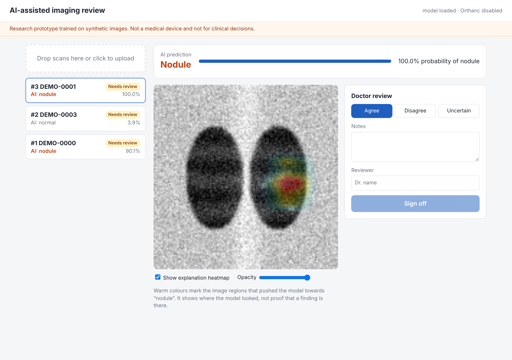
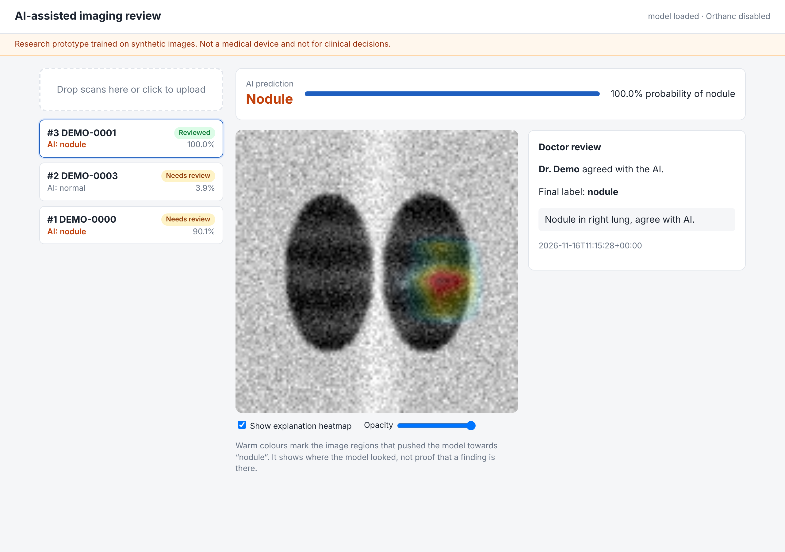
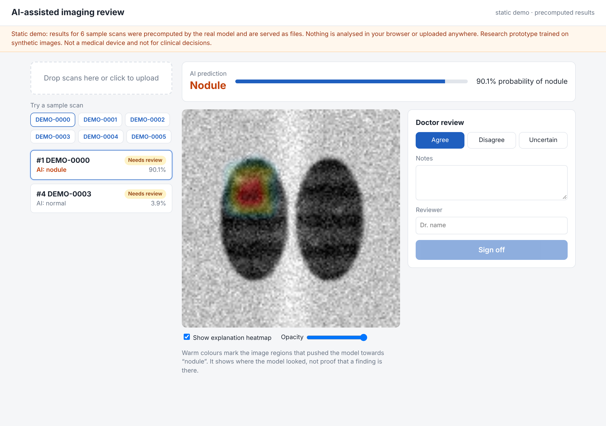

# AIML-02: AI-Assisted Medical Imaging and Diagnosis System

Upload a scan (DICOM, PNG or JPG), get a deep learning prediction with a Grad-CAM explanation heatmap, and have a
doctor review and sign off. **Research prototype trained on synthetic images. Not a medical device.**




## Live demo (GitHub Pages)

https://marutiraut2004-glitch.github.io/aiml-internship-projects/

The hosted page is a **static demo**: GitHub Pages cannot run Python, so the results for the 6 sample scans are
precomputed by the real model and Grad-CAM (`scripts/make_demo_assets.py`) and served as files. You can open a sample,
see the heatmap and fill in the doctor review (kept in the browser tab only). Uploading your own scan needs the real
backend, see "Run it". Build switch: `VITE_DEMO=true npm run build`; deployment: `.github/workflows/pages.yml`.



```
React UI ──► FastAPI backend ──► MONAI ResNet classifier ──► Grad-CAM heatmap
 (Vite)         │                                              │
                ├─► Orthanc DICOM server (DICOM uploads)       │
                └─► SQLite worklist + stored PNGs ◄────────────┘   doctor review: agree / disagree / uncertain
DVC pipeline: generate data ──► train ──► evaluate (metrics tracked)
```

| Requirement | Implementation |
|---|---|
| PyTorch, MONAI | `imaging/model.py` (MONAI `ResNet`), `imaging/train.py` (MONAI `Dataset`, `DataLoader`, transforms) |
| Grad-CAM | `imaging/gradcam.py` |
| Orthanc DICOM server | `backend/storage.py` (REST upload), `docker-compose.yml` |
| DVC | `dvc.yaml`, `params.yaml`, `dvc.lock` (generate, train, evaluate) |
| Docker | `Dockerfile`, `frontend/Dockerfile`, `docker-compose.yml` |
| React | `frontend/` (worklist, viewer with heatmap overlay, review form) |
| Doctor review | `POST /api/studies/{id}/review`, stored with reviewer, notes, timestamp |

## Run it

```bash
pip install -r requirements.txt
python -m imaging.synth                    # synthetic dataset + 6 demo DICOMs in data/samples
uvicorn backend.app:app --port 8000        # uses models/model.pt, else the bundled pretrained/model.pt
cd frontend && npm install && npm run dev  # http://localhost:5173, then upload data/samples/*.dcm
```

Retrain and evaluate (about 20 min on 2 CPU cores): `dvc repro` (or `python -m imaging.train && python -m imaging.evaluate`).
Tests: `pytest -q` (12 tests). Everything in containers: `docker compose up --build` (UI on :3000, Orthanc on :8042).
Pass DICOMs to Orthanc yourself with `python scripts/upload_samples_to_orthanc.py`.

## Results (synthetic data, 500 held-out test images)

| AUC | Accuracy | Sensitivity | Specificity | Grad-CAM pointing accuracy |
|---|---|---|---|---|
| 0.995 | 0.968 | 0.948 | 0.988 | 0.97 (random baseline 0.03) |

Pointing accuracy = share of correctly detected abnormal images where the heatmap's peak falls inside the known
nodule (plus 4 px). Files: `results/metrics.json`, `results/train_metrics.json`.

These numbers only show the pipeline works. The images are generated (lungs, ribs, noise, distractor spots and a
low contrast nodule), the task is easy, and nothing here says how it would do on real radiographs.

## Problems found and fixed (worth knowing)

1. **MONAI's `GradCAM` gave useless maps on this model.** The map was saturated (median 0.99), the peak sat at
   pixel (0, 0), and 0 of 100 peaks hit the lesion. First cause: a DenseNet with /32 downsampling has a 4x4 final
   feature map, so I switched to a small ResNet that keeps a 16x16 map. That alone did not help; the same algorithm
   written directly with a forward hook and `torch.autograd.grad` on the same layer did (95% within 12 px on
   inserted lesions). `imaging/gradcam.py` therefore uses that implementation and its docstring explains why.
   I did not find the root cause inside MONAI's class.
2. **Train/serve normalization mismatch.** Training used raw `/255` pixels while DICOM uploads were min-max rescaled.
   On the same test images specificity fell from 0.99 to 0.00. All paths now use one percentile `normalize()`, and
   `test_dicom_and_png_paths_agree` guards it. The model was retrained after this fix; the numbers above are from that run.
3. A regression test (`test_gradcam_localises_inserted_lesion`) puts a known lesion into normal images and requires the
   heatmap peak to land on it at least 80% of the time.

## Not verified

- **Orthanc and Docker were not run against a live server or built here** (no Docker daemon in the build sandbox).
  The Orthanc client is tested against a local fake HTTP server that mimics `POST /instances`, not real Orthanc.
- DVC was run end to end in a scratch copy with `dvc init --no-scm` (no git, no remote), which produced `dvc.lock`.
- Only single-frame greyscale DICOM is handled. No CT/MRI volumes, no authentication, no audit trail.
- The pretrained weights in `pretrained/` come from that DVC run; `data/` is regenerated by `python -m imaging.synth`.
