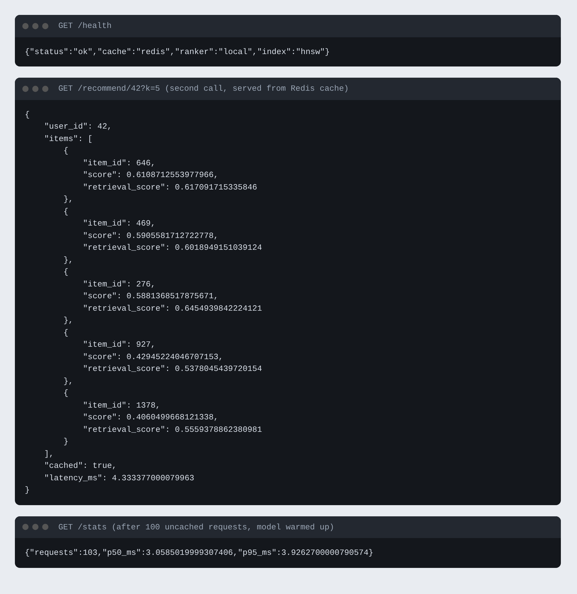
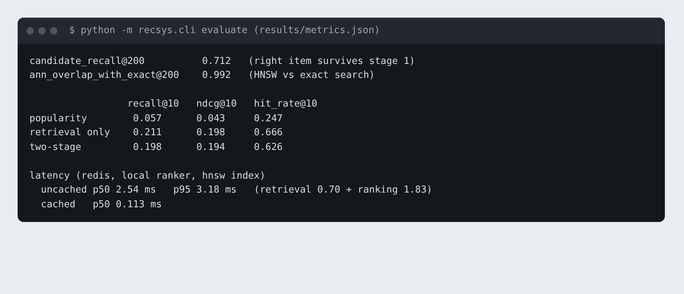
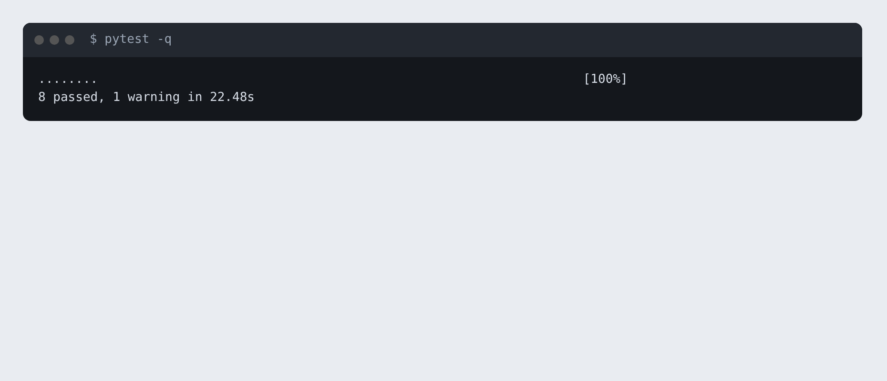

# AIML-03: Large-Scale Personalized Recommendation Engine

A two-stage recommender in the style of Netflix or Amazon. Stage one narrows 2,000 items to 200 candidates in
about half a millisecond. Stage two scores those candidates with a feature-based ranker.

```
raw CSVs ──► Spark ETL ──► parquet (train / val / test, features)
                              │
        ┌─────────────────────┴───────────────┐
        ▼                                     ▼
 TFRS two-tower retrieval              TFRS ranker (features + retrieval score)
        │ user/item embeddings                │ SavedModel
        ▼                                     ▼
   FAISS HNSW index          Redis ◄── user embeddings, features, seen items, result cache
        │                                     │
        └───────► candidates (200) ──► ranker (local or Triton) ──► top-K ──► FastAPI
                                   Airflow DAG orchestrates the offline half
```

| Piece | Tool | Where |
|---|---|---|
| Data | synthetic generator (MovieLens loader included) | `recsys/data_gen.py`, `recsys/movielens.py` |
| ETL, time-based split, features | Apache Spark (PySpark, local mode) | `recsys/spark_etl.py` |
| Stage 1 retrieval | TensorFlow Recommenders two-tower | `recsys/models.py` |
| Candidate search | FAISS (HNSW, IVF or exact) | `recsys/index.py` |
| Stage 2 ranking | TensorFlow Recommenders ranking task | `recsys/models.py` |
| Feature and result cache | Redis (falls back to memory if unreachable) | `recsys/cache.py` |
| Orchestration | Airflow DAG | `airflow/dags/recsys_pipeline.py` |
| Model serving | Triton export + HTTP client | `serving/triton/` |
| API | FastAPI | `serving/api.py` |

## Run it

```bash
pip install -r requirements.txt          # Python 3.11 to 3.13, Java 17+ for Spark
redis-server --daemonize yes             # optional; the cache falls back to memory without it

python -m recsys.cli all                 # generate -> Spark ETL -> train both stages -> evaluate (~1 min on CPU)
uvicorn serving.api:app --port 8080
curl "localhost:8080/recommend/42?k=10"

pytest -q                                # 8 tests, ~20 s
docker compose up redis api              # containerised API (after running the pipeline once)
```

Individual steps: `generate`, `etl`, `train-retrieval`, `train-ranker`, `evaluate`, `export-triton`.
Use `--users`, `--items`, `--index flat|hnsw|ivf` to change scale or index. For MovieLens 100K:
`python -m recsys.cli movielens --path ml-100k` then continue from `etl`.

## Design decisions

- **Three-way temporal split.** Per user, the newest 5 interactions are test, the 5 before are validation, the
  rest is train. The retrieval model trains on train only. The ranker trains on validation, which retrieval
  never saw, so the retrieval scores it learns from look like the ones it gets at serving time. Popularity and
  activity features never touch the test set.
- **Retrieval loss.** In-batch softmax with logQ popularity correction and removal of accidental hits.
  Embeddings are L2 normalised, so FAISS inner product is cosine similarity.
- **Ranker training data matches serving.** Negatives are sampled from the retrieved candidates (hard
  negatives), not uniformly, and the retrieval score is a ranker feature.
- **Redis layout.** Packed float32 blobs fetched with one `MGET` per request: `uemb`, `ufeat`, `ifeat`, `seen`,
  plus a TTL'd `rec:{user}:{k}` result cache.

## Results (synthetic data, 5,000 users, 2,000 items, 1,000 users evaluated)

| Metric | Popularity | Retrieval only | Two-stage |
|---|---|---|---|
| Recall@10 | 0.057 | 0.211 | 0.198 |
| NDCG@10 | 0.043 | 0.198 | 0.194 |
| Hit rate@10 | 0.247 | 0.666 | 0.626 |

- Candidate recall@200 (does the right item survive stage one): **0.712**
- HNSW overlap with exact search at k=200: **0.992**
- Latency, single process, local ranker, real Redis: uncached p50 **2.5 ms** (retrieval 0.7, ranking 1.8), p95 3.2 ms; cached p50 0.11 ms (varies a little between runs)
- The very first request after the API starts is slower (about 80 ms, TensorFlow builds its graph); the figures above are warm.
- Raw numbers: `results/metrics.json`

**Read this honestly: the ranker does not beat retrieval on this data.** Both stages beat the popularity
baseline by a wide margin, but two-stage is marginally *below* retrieval-only. The cause is the dataset: it is
generated from a latent affinity model that the two-tower retrieval already captures almost completely, so
there is no extra signal left for stage two. A ranker earns its place with features the retrieval model does
not use (recency, session context, price sensitivity). I measured two earlier versions that were worse and
fixed them: a ranker with ID embeddings memorised the ~25k validation positives (train AUC 0.999, NDCG@10
0.085), and a ranker trained on uniform negatives without the retrieval score reached 0.096. Expect different
numbers on MovieLens or real data. Synthetic metrics say the pipeline is correct, not that it would work in
production.

## What was and was not verified

Verified by running here: data generation, Spark ETL, both TFRS models, FAISS, Redis cache, the two-stage
pipeline, the FastAPI service against a live Redis, the Airflow DAG loading in Airflow's `DagBag`, and the unit
and integration tests.

Written but **not run against live infrastructure**: Triton serving (needs a Triton image that still ships the
TensorFlow backend, see `serving/triton/README.md`), the Airflow DAG executing on a schedule, and the Docker
images (`docker compose build`). Spark runs in local mode with 2 cores, which proves the logic but says
nothing about cluster-scale behaviour. Cold-start users are not supported: user embeddings are precomputed.

## Screenshots





## Layout

```
recsys/            data, ETL, models, training, index, cache, pipeline, evaluation, CLI
serving/           FastAPI app and Triton export + client
airflow/dags/      nightly retraining DAG
tests/             8 tests (data, ETL split, FAISS, cache, end-to-end, API, Triton export)
results/           metrics from the run reported above
```
